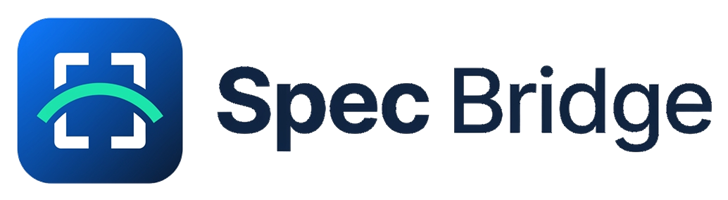

<p align="left">
  
</p>

# Spec Bridge — Community Hub & AI Agent Starter Kit

[](https://go.atlassian.com/runs-on-atlassian)
[](https://marketplace.atlassian.com/apps/562168567?tab=overview)
[](https://orphik.github.io/spec-bridge-community/)
[](https://youtu.be/oSoXlrKdjEU)
[](#quick-start-connect-your-ide-coding-agent)

**Spec Bridge** is the Spec-Driven Development (SDD) pre-flight gatekeeper for **Jira Cloud** and **Confluence**. It catches unstated edge cases, contradictions, permission holes, and scope creep *before* AI coding agents write a single line of code.

> **Official Repository Notice:** This public repository hosts the **open-source IDE Agent Starter Rules**, **Documentation**, and **Community Feature Roadmap** for Spec Bridge. Zero application source code is hosted here—Spec Bridge runs 100% natively inside Atlassian Forge Cloud with **zero external data egress**.

---

## Why Engineering & Product Teams Use Spec Bridge

AI coding agents (**Cursor, Claude Code, GitHub Copilot, Antigravity, Atlassian Rovo**) are literal executors: give them an ambiguous Jira ticket or a messy PRD, and they silently invent database columns, skip authorization checks, and gold-plate out-of-scope features.

Spec Bridge sits directly inside **Jira Work Items** across your entire hierarchy (`Portfolio Epic → Capability → Feature → Story → Subtask`):

1. **Adversarial Pre-Flight Coaching:** Scans Confluence PRDs or raw Jira descriptions (even 1-sentence asks or messy Slack threads!), surfaces blind spots as **Bilingual Decision Cards** (`PM View` + `Engineer View`), and quarantines scope creep into a **Parking Lot**.
2. **Deterministic Spec Compilation:** Compiles locked decisions + your **Project Constitution** into versioned **EARS Requirements**, **Gherkin Scenarios**, and **Explicit Non-Goals**—writing Rich Native Jira descriptions while preserving human notes (**Two-Zone Sync**) and auto-cascading into custom **Acceptance Criteria** fields.
3. **Jira Workflow Drift Gatekeepers:** Automatically flags downstream specs `DRIFTED` when a linked Confluence PRD changes or a coding agent flags an undocumented codebase constraint—blocking Jira transitions to *In Progress* until re-locked.
4. **Zero-Token Projections & Native MCP Loop:** Exports **GitHub Spec Kit**, **OpenSpec**, **Markdown**, or **JSON** instantly, and exposes native Rovo / MCP actions (`get-locked-spec`, `flag-implementation-gap`, `push-repo-surface`).

---

## Quick Start: Connect Your IDE Coding Agent

Copy the starter instruction file for your team's AI coding tool from [`./starter-kit`](./starter-kit) into the root of your software repository:

| AI Coding Agent / IDE | File to Copy into Your Repo | Destination Path |
| :--- | :--- | :--- |
| **Claude Code / Antigravity / Codex** | [`starter-kit/CLAUDE.md`](./starter-kit/CLAUDE.md) or [`starter-kit/AGENTS.md`](./starter-kit/AGENTS.md) | `./CLAUDE.md` / `./AGENTS.md` |
| **Cursor IDE** | [`starter-kit/.cursor/rules/spec-bridge.mdc`](./starter-kit/.cursor/rules/spec-bridge.mdc) | `./.cursor/rules/spec-bridge.mdc` |
| **GitHub Copilot** | [`starter-kit/.github/copilot-instructions.md`](./starter-kit/.github/copilot-instructions.md) | `./.github/copilot-instructions.md` |

Once added, prompt your coding agent directly from any Locked Jira issue using Spec Bridge's **1-Click `Copy Agent Prompt`** button:

```text
Implement Jira issue PROJ-42 strictly following its locked specification. Call get-locked-spec(issueKey: "PROJ-42", format: "speckit") first, honor all Parent Alignment Guardrails, and do NOT implement any items listed under Explicit Non-Goals.
```

---

## Pre-Code Stress Tests: Six Messy Specs vs. Literal Coding Agents

Want to see how your current refinement workflow or AI coding setup handles realistic enterprise ambiguity? Try feeding the six synthetic specs in [`./stress-tests`](./stress-tests) (contradictory three-author PRDs, pasted `#eng-product` Slack threads, Friday `?bypass_sso=true` escalations, and two-sentence destructive tickets) into your pipeline—and compare against our open-source local repository scanner, [**monkey-paw**](https://github.com/orphik/monkey-paw).

---

## Security & Privacy (`Runs on Atlassian`)

- **Zero External Network Egress:** Your Confluence PRDs, Jira issues, and Specifications **never** leave Atlassian Cloud.
- **No Training on Customer Data:** Powered exclusively by Atlassian-hosted Forge AI and isolated per-tenant Forge SQL storage.
- **Zero Source Code Required:** Optional brownfield repo mapping (`push-repo-surface`) sends only module path metadata—never proprietary source code.

See [`SECURITY.md`](./SECURITY.md) for enterprise security review details.

---

## Community-Driven Roadmap, Fast-Track CI/CD & 24h SLA Support

Spec Bridge is actively shaped by feedback from **Jira Administrators, Product Managers, Agile Coaches, Tech Leads, and AI-Assisted Engineering Teams**. Every release runs through an automated zero-egress security, type-safety, and test verification CI/CD pipeline so high-impact community improvements ship in days rather than quarters.

- **Shape the Roadmap & Share Feedback:** Open a thread in [**GitHub Discussions**](https://github.com/orphik/spec-bridge-community/discussions) or submit a [**Feature Request**](https://github.com/orphik/spec-bridge-community/issues/new/choose)—tell us what hierarchy setups, custom fields, workflow gates, or agent exports would make Spec Bridge sharper for your team.
- **Private Enterprise Support (24h SLA):** Need private assistance or enterprise onboarding? Visit our [**Support Portal (`SUPPORT.md`)**](./SUPPORT.md) and include the **Zero-PII Diagnostic Snapshot** from Spec Bridge's in-app `Support & Feature Feedback` drawer.
